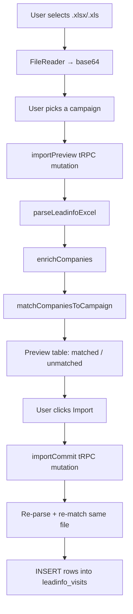
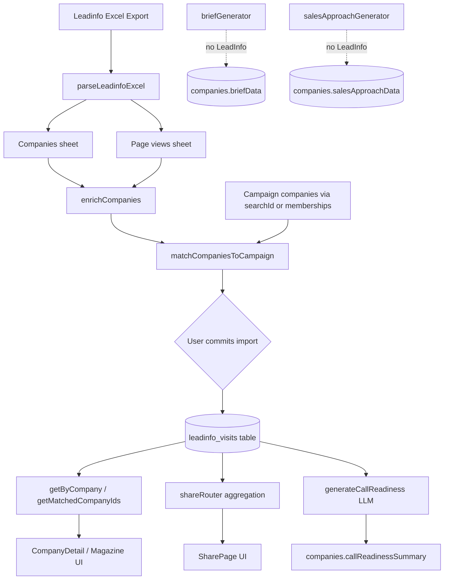

# LeadInfo Upload & Enrichment Flow

## Overview

LeadInfo is **website visitor intelligence** imported from Leadinfo SaaS Excel exports. It is a **separate intelligence layer** — not part of the Apollo/brief/sales-approach generation pipeline. The flow is:

1. Manual Excel upload → parse & enrich in memory → match to campaign companies → persist to `leadinfo_visits`
2. At display time, LeadInfo is **joined at read time** alongside company data and generated articles
3. The only field on `companies` that LeadInfo writes back to is `callReadinessSummary` ("Why Call Today"), and only when that LLM step runs

---

## 1. Upload Flow

**Entry point:** `/leadinfo` (`LeadinfoImport.tsx`), linked from the sidebar as "Leadinfo Import".



**Transport:** base64-encoded Excel via tRPC — there is no multipart REST upload or file storage. The file is parsed in memory on both preview and commit.

**Expected Excel structure:**

- **Sheet 1 — "Companies"** (or first sheet): company-level stats (name, domain, sessions, pages, duration, employees, etc.)
- **Sheet 2 — "Page views"** (aliases: "Pageviews", or second sheet): per-page visits plus persona fields (name, email, job title)

Core server logic lives in `server/leadinfoService.ts` (parsing, enrichment, matching) and `server/leadinfoRouter.ts` (tRPC API).

### Key files

| File | Role |
|------|------|
| `client/src/pages/LeadinfoImport.tsx` | Upload UI: file pick → base64, preview, commit |
| `server/leadinfoRouter.ts` | tRPC: `importPreview`, `importCommit`, `getByCompany`, `getMatchedCompanyIds` |
| `server/leadinfoService.ts` | Parse Excel, enrich, match |
| `server/routers.ts` | Mounts `leadinfo` router |
| `drizzle/schema.ts` | `leadinfo_visits` table definition |

---

## 2. In-Memory Enrichment (During Import)

`enrichCompanies()` merges the Companies sheet with Page views **by company name** (case-insensitive):

| Computed field | How it's derived |
|---|---|
| `engagementScore` | `sessions × log(duration+1) × pageDepthMultiplier`, capped at 100 |
| `intentSignals` | Regex patterns on page URLs/titles (contact, pricing, demo, careers, etc.) |
| `topPages` | Top 5 most-viewed page titles |
| `personas` | Deduplicated from page-view rows (by email or name) |
| `pagesViewed` | Full list of `{ url, title, duration, visitedAt }` |

Domain normalisation (`normaliseDomain`) strips protocol, `www`, path, etc. → `example.com`.

---

## 3. Matching to Campaign Companies

`matchCompaniesToCampaign()` links LeadInfo rows to companies in the selected campaign:

1. **Campaign scope** — companies with native `searchId` **or** linked via `search_company_memberships` (Apollo dedup junction)
2. **exact_domain** — normalised LeadInfo domain === campaign company domain
3. **fuzzy_domain** — first label match (e.g. `eaton` ↔ `eaton.com`), min 4 chars
4. **unmatched** — stored with `companyId = null` unless user opts in via `includeUnmatched`

On commit, one row per parsed company is inserted into `leadinfo_visits` with a shared `importBatchId` UUID. Re-imports create new rows (no dedup); `getByCompany` returns the most recent by `importedAt`.

---

## 4. How Company Data Gets "Enriched"

LeadInfo does **not** update firmographics or other `companies` columns during import. Enrichment happens at **read/display time**:

| Surface | Mechanism |
|---|---|
| **Campaign list** (`SearchResults.tsx`) | `getMatchedCompanyIds` → "SITE VISITOR" badge, filter, +5000 sort boost |
| **Company detail** (`CompanyDetail.tsx`, `CompanyDetailMagazine.tsx`) | `getByCompany` → dedicated "WEBSITE VISITOR / LEADINFO" block |
| **Share pages** (`SharePage.tsx`) | `shareRouter` aggregates visit rows into a `leadinfo` object |
| **Why Call Today** (`companyFinder.ts`) | `generateCallReadiness` / `batchRefreshCallReadiness` reads LeadInfo as **highest-priority** LLM context → writes `companies.callReadinessSummary` |

### Runtime lookup (`getByCompany`)

1. Direct match: `leadinfo_visits.companyId = companyId` (latest by `importedAt`)
2. Fallback: normalise company domain → match any `leadinfo_visits.domain` (best `engagementScore`)

### Cross-campaign visibility

`getMatchedCompanyIds` also flags a campaign company as a site visitor if **any** LeadInfo record anywhere shares its domain — even from a different campaign import.

---

## 5. How "Articles" Relate to LeadInfo

In this codebase, "articles" means generated content stored on the company row:

- **Research brief** → `companies.briefData` (via `briefGenerator.ts`)
- **Sales approach** → `companies.salesApproachData` (via `salesApproachGenerator.ts`)

**LeadInfo is not woven into these at generation time.** `briefGenerator`, `salesApproachGenerator`, and `campaignQueueWorker` have zero LeadInfo references. The campaign queue runs fit score → brief → approach without ever reading `leadinfo_visits`.

Instead, on company pages LeadInfo appears as a **parallel block** next to the brief/approach articles — fetched separately via `trpc.leadinfo.getByCompany` and rendered in its own UI section (engagement score, sessions, intent signals, top pages, personas).

The one indirect article-like enrichment is **Why Call Today**: the LLM prompt explicitly says to lead with website visits when present (`server/prompts/index.ts` — rule 5: "If a website visit (Leadinfo) exists, ALWAYS lead with that — it is the strongest buying signal."). That produces a one-line `callReadinessSummary` on the company — not a full brief or sales approach rewrite.

---

## 6. Data Model

```
users ──→ leadinfo_visits.userId
searches (campaigns) ──→ leadinfo_visits.searchId
companies ──→ leadinfo_visits.companyId (nullable if unmatched)
```

### `leadinfo_visits` columns (summary)

| Column | Description |
|--------|-------------|
| `id` | PK |
| `userId`, `searchId`, `companyId` | FKs (companyId nullable if unmatched) |
| `companyName`, `domain`, `rawUrl` | Identity from Leadinfo |
| `city`, `country`, `salesRegion`, `employees`, `branch`, `linkedinUrl`, `salesVolume` | Firmographics |
| `totalPages`, `totalSessions`, `totalDuration`, `engagementScore` | Engagement metrics |
| `pagesViewed`, `topPages`, `intentSignals`, `personas` | JSON blobs |
| `importBatchId`, `importedAt` | Batch grouping |

There is **no Supabase sync** for LeadInfo yet (planned `lt_leadinfo_visits` in `todo.md`, not implemented). No cron jobs or background workers — entirely manual upload.

---

## Architecture Diagram



---

## Key Design Points

1. **Two-phase import** — preview before commit; commit re-parses the file (no server-side staging)
2. **Domain matching at import, name matching for page views** — Companies↔Page views join by company name; Companies↔campaign join by domain
3. **Read-time enrichment, not write-time** — LeadInfo stays in its own table and is joined when pages load
4. **Articles are not auto-enriched** — brief/sales approach generation ignores LeadInfo; only the separate "Why Call Today" summary prioritises it
5. **`includeUnmatched` quirk** — In the UI, the `showUnmatched` toggle both expands the unmatched table and is passed as `includeUnmatched` to commit, so expanding unmatched visitors also imports them
